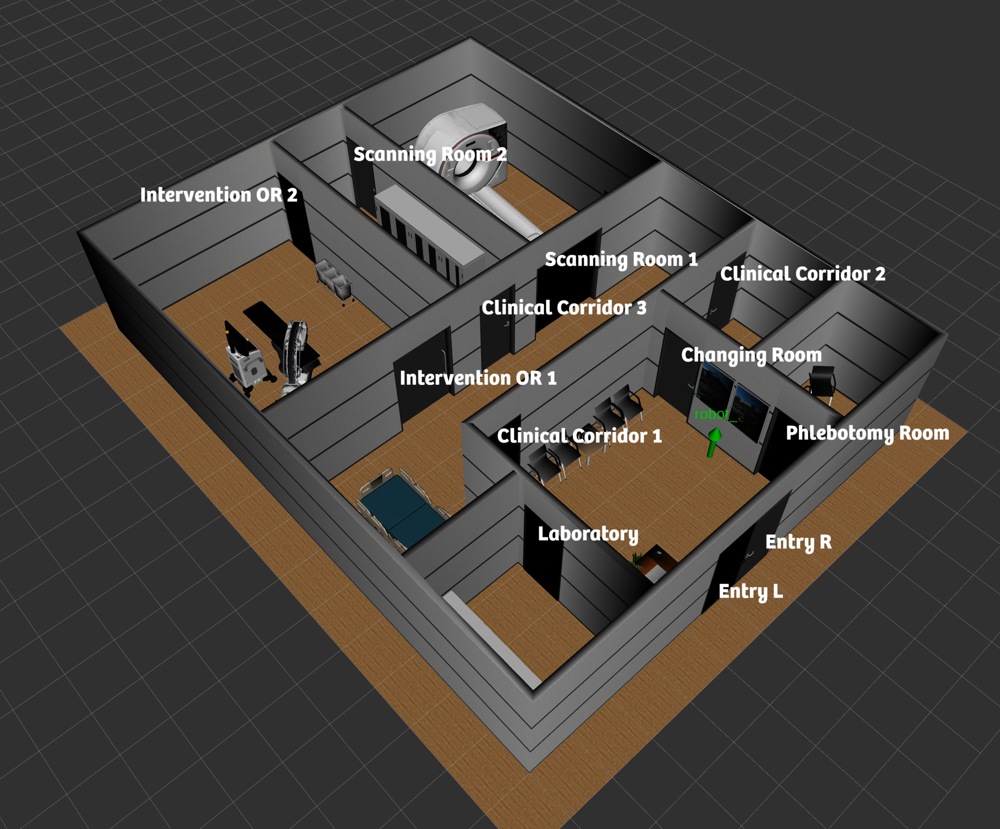

# Hospital Controller (ROS 2)

The Hospital Controller is a ROS 2 project that simulates the environment of the “Healthcare Challenge at RoboCup 2027.” In addition to simulating ROS 2 interfaces similar to those used in the real competition, it provides a visual layer and virtual environment for training.

C++ controllers model automatic **doors**, a **CT scanner** with a motorised patient
table, a **laboratory blood analyser**, and an **operating room**. An RViz panel
provides operator controls and mission dispatch alongside a live 3D hospital
scene. Protocol-driven simulated robots demonstrate the workflows, while an
activity logger records room visits and mission durations.


This README is the central project guide. The `hospital_bringup` package contains
the system launch files and shared configuration that connect the other
packages; their READMEs provide the detailed references linked below.

<p align="center">
  
</p>

## Requirements

- **ROS 2 Jazzy Jalisco**, installed and sourced: [installation guide](https://docs.ros.org/en/jazzy/Installation.html).
- **C++20 compiler**, such as GCC 13, and the `colcon` build tools.
- **ROS dependencies**, including RViz, `robot_state_publisher`, `xacro`, and Qt5 development libraries. Resolve package dependencies with `rosdep`.
- **A graphical session** for the RViz operator interface.

## Build

Put the packages directly under `src/` in a ROS 2 workspace. A clone of this
repository already has this layout, so the repository root is the workspace
root. Run the commands below in the workspace root (the directory that
contains `src/`), not from inside `src/` or an individual package:

```text
ros2_ws/                         # workspace root: run commands here
└── src/
    ├── hospital_interfaces/
    ├── hospital_controller/
    ├── hospital_robot/
    ├── hospital_rviz_panel/
    ├── hospital_arena/
    ├── hospital_description/
    └── hospital_bringup/
```

```bash
cd /path/to/ros2_ws  # replace with your workspace path; this directory contains src/
```

```bash
source /opt/ros/jazzy/setup.bash
rosdep install --from-paths src --ignore-src -r -y
colcon build
source install/setup.bash
```

Building the full workspace ensures the controllers, clients, model, and launch
dependencies are available together. After source or configuration changes,
rebuild the affected packages, source the workspace again, and relaunch.

## Run

In each new terminal, source ROS 2 and the built workspace. Start the application
with the system launch:

```bash
source /opt/ros/jazzy/setup.bash
source install/setup.bash
ros2 launch hospital_bringup bringup.launch.py
```

This starts the four controllers, configured robot fleet, activity logger,
RViz panel, arena joint bridge, and `robot_state_publisher`. The panel and the
animated model share one RViz window. Recording is initially disabled; starting
the logger does not automatically start a recording session.

The normal workflow is to operate devices in the panel, select a robot and
mission in Ward Management, and optionally start activity recording before
dispatching missions. Stop recording to finalize the output, and stop the
application with Ctrl+C in its launch terminal.

### Launch Configuration

The current launch enables all subsystems by default. These arguments are
available for integration scenarios; disabling a required subsystem can leave
controls, missions, or visualization unavailable.

| Argument | Default | Effect |
| --- | --- | --- |
| `params_file` | Installed `config/hospital_params.yaml` | Shared parameters for controllers, robots, logger, and panel. |
| `description_package` | `hospital_description` | Package that provides `urdf/hospital.urdf.xacro` and the meshes. |
| `use_sim` | `true` | Start the four simulated device controllers. |
| `use_rviz` | `true` | Start RViz and the arena/model bridge together. |
| `use_robots` | `true` | Start the bundled simulated robot fleet. |
| `use_logging` | `true` | Start the activity logger. |

To use a complete custom parameter file:

```bash
ros2 launch hospital_bringup bringup.launch.py \
    params_file:=/absolute/path/to/hospital_params.yaml
```

Use this instead of starting another application instance alongside the first.
Individual package launches are not needed for normal operation.

## Architecture

Device controllers are the authoritative source of building state. Robots and
the RViz panel command devices through ROS 2 actions and services. State topics
and action feedback let clients observe the same devices without owning or
duplicating their simulation logic.

The arena bridge reads device telemetry and publishes joint positions.
`robot_state_publisher` combines these with the hospital model to produce TF
for RViz. The panel is a C++/Qt plugin inside `rviz2`; the bridge, controllers,
robots, and logger run separately.

### Packages

| Package reference | Responsibility |
| --- | --- |
| [hospital_interfaces](../hospital_interfaces/README.md) | Shared message, service, and action definitions for devices, missions, and timing. |
| [hospital_controller](../hospital_controller/README.md) | Four composable C++ device controllers and their authoritative state. |
| [hospital_robot](../hospital_robot/README.md) | Simulated mission servers, robot poses/markers, and pose-based activity recording. |
| [hospital_rviz_panel](../hospital_rviz_panel/README.md) | RViz operator plugin, device controls, Ward Management, and recording controls. |
| [hospital_arena](../hospital_arena/README.md) | Device-to-joint bridge and live model publication. |
| [hospital_description](../hospital_description/README.md) | Hospital URDF/xacro, articulated joints, and mesh assets. |
| `hospital_bringup` | System composition and shared launch-time configuration, documented here. |

## Devices and Workflows

### Doors

Named doors accept open/close goals and report status and opening percentage.
Different doors can move concurrently. A busy door, unknown ID, or request for
an already reached end state is rejected. Cancellation stops at the current
opening. See [door behavior and parameters](../hospital_controller/README.md#doors).

Door device IDs use lowercase snake_case; RViz uses separate readable labels.
The doors are:

| Door ID | Display label |
| --- | --- |
| `entry_l` | Entry L |
| `entry_r` | Entry R |
| `laboratory` | Laboratory |
| `phlebotomy_room` | Phlebotomy Room |
| `changing_room` | Changing Room |
| `clinical_corridor_1` | Clinical Corridor 1 |
| `clinical_corridor_2` | Clinical Corridor 2 |
| `clinical_corridor_3` | Clinical Corridor 3 |
| `intervention_or_1` | Intervention OR 1 |
| `intervention_or_2` | Intervention OR 2 |
| `scanning_room_1` | Scanning Room 1 |
| `scanning_room_2` | Scanning Room 2 |

External door clients must send these IDs. Model links use those same IDs,
with `_hinge` or `_slide` joint suffixes. Mesh filenames retain their original
asset names. Room waypoint/logging IDs, tower diagnostic names, and CT scanner
interfaces are independent identifiers.
Rebuild and restart the complete application so all consumers use the same IDs.

### CT Scanner

The CT has a vertical lift and a horizontal tabletop. `MoveTable` raises or
lowers the lift; `RunScan` raises it to TOP before an out-in-out gantry sweep.
Radiation is simulated and active during the sweep only.

RunScan feedback distinguishes procedure phase, vertical lift height, and
horizontal sweep progress. `/hospital/ct/scan/procedure_state` retains the last
procedure snapshot for observers, while the two axis topics remain the live
position sources. The scan stopwatch excludes lift preparation and recovery.

Canceling a scan or sending STOP holds the current position with radiation off;
it does **not** retract automatically. After the scan unit is idle, RETRACT
pulls the tabletop out, then DOWN can lower the lift. Cancel a plain lift goal
to stop that movement. See [CT behavior and recovery](../hospital_controller/README.md#ct-scanner).

### Laboratory and Operating Room

The laboratory performs a timed blood analysis and returns simulated cTnT,
cTnI, and CK-MB results. The operating room exposes CLEAN/DIRTY and a simulated
X-ray flag. Cleanliness uses a service; X-ray activity uses a node parameter.
The controller publishes the updated state after an X-ray parameter change;
the state topic is latched so late subscribers receive the latest snapshot.
See the [laboratory](../hospital_controller/README.md#laboratory) and
[operating-room](../hospital_controller/README.md#operating-room) references.

### Ward Management

Robots serve `ExecuteTask` missions: `CLEAN_OR`, `COLLECT_LAB`, `GUIDE_CT`,
`HEART_ATTACK`, and `SURGICAL_ASSIST`. Each simulated robot executes one mission
at a time while additional accepted goals wait in FIFO order and can be
cancelled while queued. Multiple robots can run
concurrently but share the building devices. They teleport between configured
room waypoints rather than plan collision-free paths.

The purpose of those simple robots is to demonstrate the ward management and mission dispatch system.

See [mission protocols and robot interfaces](../hospital_robot/README.md#robot-api-and-missions)
and [operator controls](../hospital_rviz_panel/README.md#controls-and-interfaces).

## ROS 2 Interfaces

The following is an index; the
[interface reference](../hospital_interfaces/README.md#interface-reference)
defines the fields, constants, feedback, and result types.

| Endpoint | Kind / type | Owner |
| --- | --- | --- |
| `/hospital/doors/operate` | Action: `OperateDoor` | Door controller |
| `/hospital/doors/state`, `/hospital/doors/states` | Topics: `DoorState`, `DoorStateArray` | Door controller |
| `/hospital/doors/get_states` | Service: `GetDoorStates` | Door controller |
| `/hospital/ct/table/move` | Action: `MoveTable` | CT controller |
| `/hospital/ct/scan/run` | Action: `RunScan` | CT controller |
| `/hospital/ct/table/state`, `/hospital/ct/scan/state` | Topics: `CtTableState`, `CtScannerState` | CT controller |
| `/hospital/ct/scan/procedure_state` | Topic: `CtScanProcedureState` (transient-local, KeepLast 1) | CT controller |
| `/hospital/lab/analyze`, `/hospital/lab/state` | Action: `AnalyzeBlood`; topic: `LabState` | Lab controller |
| `/hospital/operating_room/set_cleanliness` | Service: `SetCleanliness` | Operating-room controller |
| `/hospital/operating_room/get_state`, `/hospital/operating_room/state` | Service: `GetOperatingRoomState`; topic: `OperatingRoomState` | Operating-room controller |
| `/hospital/stopwatch` | Topic: `Stopwatch` | Device controllers |
| `/hospital/<robot_id>/ward/execute_task` | Action: `ExecuteTask` | Selected robot |
| `/hospital/<robot_id>/pose`, `/hospital/robot_markers` | Topics: `geometry_msgs/PoseStamped`, `visualization_msgs/MarkerArray` | Robots |
| `/hospital/task_events` | Topic: `TaskEvent` | Mission-dispatch client (bundled panel) |
| `/hospital/logging/set_recording` | Service: `std_srvs/SetBool` | Activity logger |

Custom types are provided by `hospital_interfaces`. Key device states and
stopwatches use transient-local durability. Operating-room state is published
at startup, on accepted cleanliness requests, and on X-ray parameter changes;
the `get_state` service only returns the current state. Device durations are
controller-measured; mission durations are panel-measured and forwarded to the
logger.

### Command-Line Examples

With the complete application already running, use a second sourced terminal.
These commands operate existing servers; they do not start partial subsystems.
Run them individually and wait for completion before a dependent command.

```bash
# Open a configured door (0 = open, 1 = close)
ros2 action send_goal --feedback /hospital/doors/operate \
    hospital_interfaces/action/OperateDoor "{device_id: 'scanning_room_1', command: 0}"

# Run a scan; it raises the lift before the gantry sweep
ros2 action send_goal --feedback /hospital/ct/scan/run \
    hospital_interfaces/action/RunScan "{command: 0}"

# Lower the table after the scan finishes (0 = up, 1 = down)
ros2 action send_goal /hospital/ct/table/move \
    hospital_interfaces/action/MoveTable "{command: 1}"

# Analyse blood
ros2 action send_goal --feedback /hospital/lab/analyze \
    hospital_interfaces/action/AnalyzeBlood "{command: 'START_BLOODTEST'}"

# Mark the operating room dirty (0 = DIRTY, 1 = CLEAN)
ros2 service call /hospital/operating_room/set_cleanliness \
    hospital_interfaces/srv/SetCleanliness "{target_state: 0}"

# Dispatch a mission to the configured robot
ros2 action send_goal --feedback /hospital/robot_1/ward/execute_task \
    hospital_interfaces/action/ExecuteTask \
    "{value: 0, task_id: 'clean-demo-1'}"
```

CT and lab goals do not contain a `device_id`. Direct CLI mission dispatch does
not emit the panel's `TaskEvent` messages, so it does not automatically create
task-duration records. Avoid concurrent manual commands to devices a robot is
using; busy-device goals may be rejected.

## Configuration

[config/hospital_params.yaml](config/hospital_params.yaml) is the shared
configuration. Parameters are grouped by node under `ros__parameters`:

| Section | Configuration |
| --- | --- |
| `door_controller_node` | Door IDs, open/close durations, and update rate. |
| `ct_scanner_controller_node` | Lift duration, scan duration, and update rate. |
| `lab_controller_node` | Analysis duration, update rate, and launch-time abnormal-results flag. |
| `operating_room_controller_node` | Initial simulated X-ray activity. |
| `robot_server_node` | Shared room waypoints, interaction/travel timings, frames, driven endpoints, and controller result-timeout settings. |
| `activity_logger_node` | Robot roster, room boundaries, debounce, and log directory. |
| `rviz2` | Robot roster offered by the panel. |

Current configured timings are `5 s` for door opening/closing and CT lift
movement, `10 s` for a CT sweep, and `10 s` for laboratory analysis.
`cardiac_abnormal` is initially `true`. Door IDs and that flag are launch-time
settings. See [controller parameters](../hospital_controller/README.md#configuration-and-checks)
for device details. The panel's door layout and arena joint mappings are fixed
in code; changing a YAML ID alone does not create a matching control or joint.


## Activity Recording

Use the panel's Start/Stop Recording controls in Ward Management. The logger
infers room occupancy from robot poses and records each visit separately.
Task records use the panel's lifecycle events and measured durations, excluding
queued time. Room recording also works with compatible third-party robot poses.

An empty `log_directory` uses `$HOME/hospital_logs`. Each session contains:

```text
run_<YYYYMMDD_HHMMSS>/
  robot_1/
    rooms.csv
    tasks.csv
  run.json
```

Stop recording normally to close active visits and write the JSON report.
See [recording behavior and integration requirements](../hospital_robot/README.md#activity-recording).

## License

Copyright (c) 2026 Siemens Healthineers AG

SPDX-License-Identifier: GPL-3.0-or-later

The package's first-party code and configuration are licensed under the
[GNU General Public License, version 3 or later](LICENSE). The license does
not grant trademark rights; see the [trademark notice](../../NOTICE).
